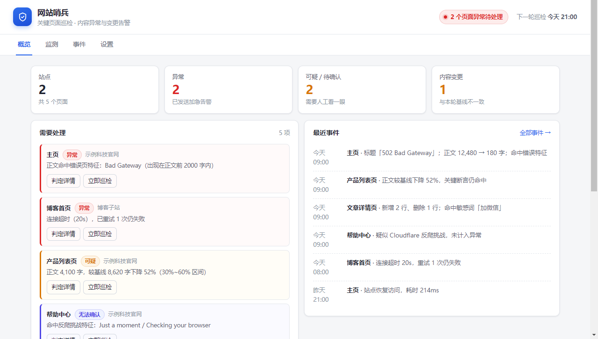
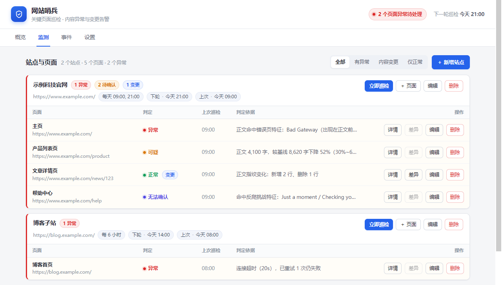
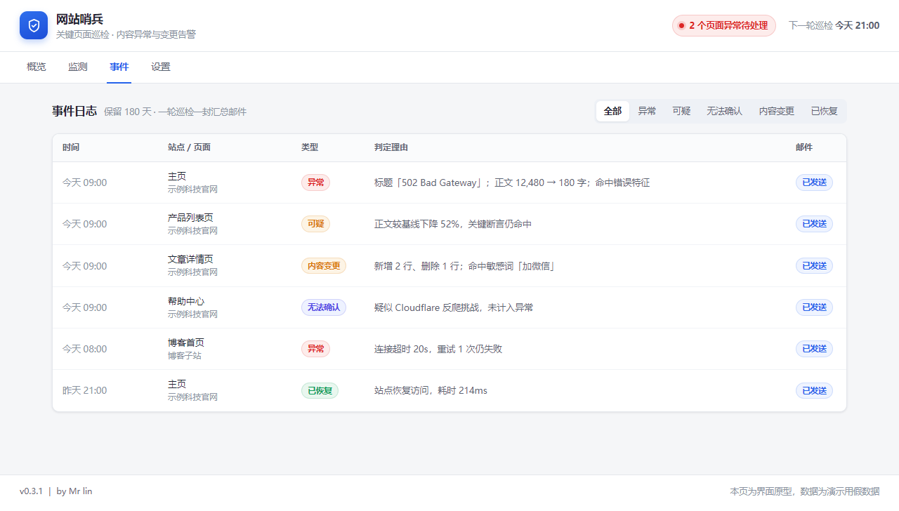
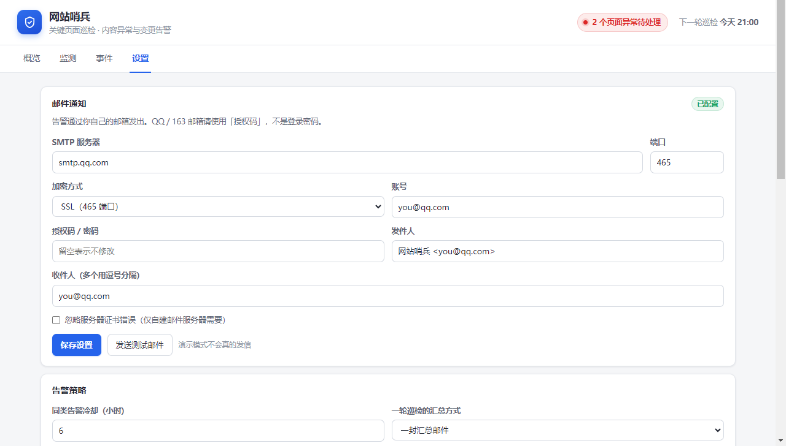

# 网站哨兵 Site Guard

> **网站哨兵** · Node.js 22 + SQLite + 原生前端 ｜ 定时巡检关键页面，用"内容"而不是状态码判断网站是否正常，异常与篡改直接发邮件到你的邮箱。


[English](#english) | [中文](#中文)

> ⚠️ **当前阶段**：`0.8.0` 起正式面板已接入真实 API——初始化/登录、站点与页面管理、巡检进度与日志、判定详情、差异与基线、事件流、邮件设置与测试邮件全部可用；`0.8.1` 修复了飞牛桌面入口（`/app/siteguard` 无尾斜杠）下 CSS/JS 404 的问题（实机已确认样式正常）；`0.8.2` 修复了飞牛网关改写 `Host` 导致初始化/登录报「跨站请求被拒绝」的问题。`.fpk` 已在飞牛 fnOS 实机安装验证通过，Docker 镜像已推送阿里云 ACR。
> 想在电脑上试：`npm start` 后打开 `http://127.0.0.1:8686`，首次会要求设置管理密码。`prototype/` 保留为设计参考（假数据）。部署请以 [DEPLOY.md](doc/DEPLOY.md) 为目标流程参考。

---

## 中文

### ✨ 这是什么

- 一个**自己部署**的网站巡检工具：装在 NAS 的 Docker 里，浏览器打开就能用，数据全在自己手里。
- 它不靠 HTTP 200 判断"网站正常"，而是把页面抓下来看**内容像不像一页正常网站**——返回 200 的 `502 Bad Gateway`、空白页、维护页、跳去别的域名，都会被判为异常。
- 它记得你网站"原来长什么样"（基线），之后每次巡检对比：文字变了就报"内容变更"，打不开就报"异常"。
- 一轮巡检只发**一封汇总邮件**，只在状态变化时发，不会把你邮箱刷爆。
- 按天或按小时巡检（默认每天 09:00、21:00），对目标站点压力很小。

### 🎯 核心特性

| 特性 | 说明 |
| --- | --- |
| 内容优先的健康判定 | 传输层 + 响应层 + 内容层三层证据，结论分**正常 / 可疑 / 异常 / 无法确认**四档，每条都附判定理由 |
| 关键页面巡检 | 一个站点下挂多个页面（主页、列表页、详情页），统一计划、统一批次 |
| 内容变化比对 | 正文指纹 + 逐行差异；内置日期/访问量/随机串忽略规则，减少误报 |
| 关键断言 | 每页可配"必须包含的文字"（公司名、备案号），缺失即判异常 |
| 反爬与 SPA 识别 | 遇到 Cloudflare 挑战或 JS 空壳页，如实判"无法确认"，不冒充异常 |
| 汇总邮件告警 | 一轮一封、主题按严重度分级；正文含判定理由与差异摘录；同类内容变更 6 小时冷却，恢复不受限；失败自动重试 2 次 |
| 中文面板 | 概览 / 监测 / 事件 / 设置四个页签，适配手机 |
| 单容器自托管 | 零原生依赖，SQLite 单文件，备份就是拷 `data/` 目录 |

### 📸 界面

| 概览 | 监测 |
| --- | --- |
|  |  |

| 事件 | 设置 |
| --- | --- |
|  |  |

### 🚀 快速开始

#### 使用者（部署即用）

> 0.7.0 起交付 **飞牛原生应用（.fpk）**，不需要 Docker、不占端口。

1. 构建端跑 `node scripts/build-fnos.mjs`，得到 `dist/fnos/siteguard-<版本>-x86.fpk`（或 `-arm.fpk`，按 NAS 架构选）。
2. NAS 上打开应用中心 → 本地安装 → 选中 `.fpk` → 安装。
3. 桌面点开「网站哨兵」，它在统一网关下以 `/app/siteguard` 打开。
4. 设置管理密码 → 添加站点与关键页面 → 填 SMTP 发测试邮件 → 点「立即巡检」建基线。

构建、升级、卸载、日志位置与故障排查见 [DEPLOY.md](doc/DEPLOY.md) 第 1 节。

**看设计原型（可选）**

```bash
# 方式一：直接双击
prototype/index.html

# 方式二：起一个本地静态服务（推荐，避免个别浏览器限制）
cd prototype && python3 -m http.server 8899
# 打开 http://127.0.0.1:8899
```

`prototype/` 是纯静态假数据的设计参考，右下角可切换「空状态 / 有数据 / 异常」三种场景；正式界面在 `public/`，随应用一起提供。

#### 开发者（从源码构建）

```bash
# 后端零原生依赖；nodemailer 用于发信（唯一依赖，纯 JS，无需编译）
npm install

# 启动：默认 http://127.0.0.1:8686，数据写到 ./data
npm start
npm run dev      # 改代码自动重启
npm test         # 111 条用例（node --test），当前全绿

# 常用环境变量
PORT=9000 DATA_DIR=./data TZ=Asia/Shanghai npm start
```

首次打开会要求设置管理密码（至少 8 位），之后用该密码登录。给站点添加页面后点「立即巡检」建立基线，改动页面内容再跑一次即可看到差异；在「设置 → 邮件通知」里填好 SMTP 并点「发送测试邮件」验证后，每轮巡检的异常/变更会汇总成一封邮件。面板四个页签（概览/监测/事件/设置）直接操作真实数据，无需再借道 HTTP 接口。

```bash
# 打包飞牛原生应用（需要 fnpack，FNPACK_BIN 指向它或放进 PATH）
node scripts/build-fnos.mjs            # 出 dist/fnos/siteguard-<版本>-x86.fpk 与 -arm.fpk
node scripts/build-fnos.mjs --arch x64 # 只出一个架构

# Docker 镜像（备用路径，已可构建）
docker build -f deploy/Dockerfile -t site-guard:0.8.2 .
docker run --rm -p 8686:8686 -v "$PWD/data:/data" -e TZ=Asia/Shanghai site-guard:0.8.2
```

### 🛠️ 技术栈

| 层 | 选型 | 说明 |
| --- | --- | --- |
| 运行时 | Node.js 22 LTS | 自带 `fetch` 与 `node:sqlite`，**零原生依赖**，ARM/x86 都能构建 |
| 存储 | SQLite（WAL，单文件） | 无需数据库容器；备份 = 拷 `data/` |
| 后端 | 内置 `node:http` | 轻量路由，无框架 |
| 前端 | 原生 HTML/CSS/JS | 无构建链，镜像小，改完即生效 |
| 邮件 | nodemailer（MIT） | 唯一依赖，支持 SSL/STARTTLS/授权码 |
| 部署 | 飞牛原生应用（.fpk）+ Docker 镜像 | 统一网关 Unix Socket 不占端口、自带 Node 运行时；Docker 镜像已推送阿里云 ACR（备用） |

### 🔒 数据与隐私

- 所有数据只存在你的 NAS：data-share 目录里的 `app.db` 一个文件。
- 不收集、不上报任何使用数据；没有云端账号，没有第三方统计。
- 只访问你自己配置的页面 URL；不探测目录、不做路径猜测、不绕过登录。
- SMTP 授权码保存在本地数据库，界面读取时一律脱敏显示。
- 出网仅需 443（目标站点）与你的邮件服务器端口。

### 📁 项目结构

```
site-guard/
├── README.md              # 本文件：面向使用者
├── CHANGELOG.md           # 版本历史与详细更新日志
├── package.json           # 版本、脚本、唯一依赖
├── doc/
│   ├── DESIGN.md          # 设计方案：需求评估、判定逻辑、选型对比
│   ├── PROJECT.md         # 开发技术文档：架构、数据模型、规则表、接口
│   ├── PROJECT_STATE.md   # 状态与交接：做到哪、踩过什么坑
│   ├── DEPLOY.md          # 部署手册：NAS、Compose、备份、排查
│   ├── TEST.md            # 测试文档：用例、实际结果、回归清单
│   └── images/            # README 截图
├── prototype/             # 界面原型（纯静态，可直接打开，不参与构建）
├── src/                   # 后端源码（server / routes / db / auth / scheduler / runner …）
├── public/                # 正式前端：index.html / style.css / app.js（四页签面板，直连真实 API）
├── fnos/                  # 飞牛包目录：manifest / cmd / config / wizard / ui
├── deploy/                # Dockerfile（Docker 镜像构建，备用路径）
├── test/                  # node:test 用例
├── scripts/               # build-fnos.mjs 打包、make-icons.mjs 图标、镜像推送
└── tools/                 # 运维小工具（备份导出等）
```

> 当前 `public/` 已由设计原型演进为正式面板（四页签 + 登录/初始化 + 弹窗），`prototype/` 仅作设计参考；`fnos/` 已可打包出 `.fpk`（`app/server/` 与 `*.fpk` 是构建产物，已 gitignore）；`test/` 已有 111 条用例，覆盖抓取、正文提取、四档判定、差异、邮件汇总、接口与网关/Socket。

### 🖱️ 常用操作

> 以下操作在正式面板（`public/`）里直接可用，背后调用的是同源 `/api/*` 接口。

| 想做什么 | 怎么做 |
| --- | --- |
| 添加一个网站 | 监测 → ＋新增站点 → 填名称与地址 → 选计划（每天定时 / 每 N 小时） |
| 监控某个内页 | 站点卡片 → ＋页面 → 填 URL；建议补「必须包含的文字」 |
| 避免"内容变更"误报 | 页面编辑 → 忽略规则，一行一条正则（日期、访问量、随机串） |
| 确认改版是正常的 | 概览 → 需要处理 → 设为基线 |
| 立刻跑一次 | 站点卡片 → 立即巡检（不影响原计划） |
| 换收件邮箱 | 设置 → 邮件通知 → 改收件人 → 发送测试邮件 |
| 改巡检时间 | 站点 → 编辑 → 每天定时（如 `09:00, 21:00`）或每 N 小时 |

### 🐛 故障排查

| 症状 | 原因 / 修复 |
| --- | --- |
| 打不开面板 | 端口被占用或容器未启动：`docker compose logs --tail=100`，改 `ports` 左侧端口 |
| 时间差了 8 小时 | 没设时区：compose 里加 `TZ: Asia/Shanghai` 并重建 |
| 测试邮件 535 / EAUTH | 用了邮箱登录密码：QQ/163 必须用「授权码」 |
| 测试邮件超时 | 端口与加密方式不匹配：465 用 SSL，587 用 STARTTLS |
| 所有页面都"无法确认" | 目标站反爬或本机 IP 被限：降低频率，查看判定理由 |
| 每天收到"内容变更" | 页面有动态内容：补忽略规则（日期、访问量、`csrf-token`） |
| 邮件进了垃圾箱 | 发件域名无 SPF：用常用邮箱并把发件人加白名单 |

### 📜 更新日志

详见 [CHANGELOG.md](CHANGELOG.md)。

### 📄 许可证

MIT License。

---

## English

### What is this

**Site Guard** is a self-hosted website monitoring tool for your NAS. Instead of trusting HTTP 200, it fetches each key page and decides whether the **content** still looks like a healthy page — so a `502 Bad Gateway` served with status 200, a blank page, a maintenance page or a redirect to another domain is reported as an incident. It keeps a baseline of each page, reports content changes with a line diff, and sends **one digest email per run** to your inbox.

Current stage: `0.8.2` ships the real web UI (setup/login, sites and pages, live run progress and logs, verdict details, diffs and baselines, event feed, mail settings) wired to the API, on top of the existing four-level verdicts, baselines and digest emails.

### Tech Stack

Node.js 22 (built-in `fetch` + `node:sqlite`, no native deps) · SQLite single file · vanilla HTML/CSS/JS frontend · nodemailer as the only dependency · single Docker container.

### Quick Start

```bash
# Try the static prototype right now
cd prototype && python3 -m http.server 8899   # open http://127.0.0.1:8899
# or simply open prototype/index.html
```

Deployment (once the backend lands) is a single `docker compose up -d` with `./data:/data`; see [doc/DEPLOY.md](doc/DEPLOY.md).

### Data & Privacy

Everything stays on your NAS in `/data/app.db`. No cloud account, no telemetry, no third-party analytics. It only requests the URLs you configure, never probes directories, and never bypasses logins. SMTP credentials are stored locally and always masked when read back.

### License

MIT.

---

<sub>by Mr lin · v0.8.2</sub>
